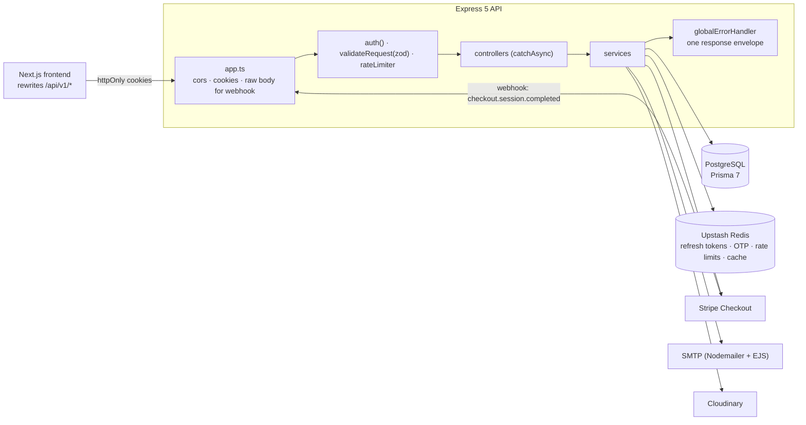
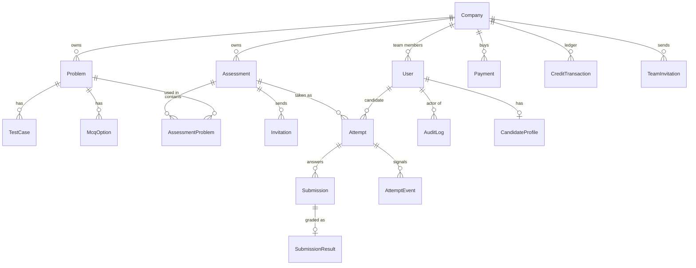

<div align="center">

# DevBench API

**The REST API behind DevBench, a developer assessment platform.**

Companies build coding, MCQ and written problems, bundle them into timed assessments, invite candidates by email, and review the results with an integrity check and candidate insights. Credits are bought through Stripe and spent one per invitation.

[](https://devbench-backend.vercel.app/)
[](https://devbench-frontend-ten.vercel.app/)
[](https://github.com/abdullahmamun1/devbench-frontend)


</div>

## Table of contents

- [What the API solves](#what-the-api-solves)
- [Architecture](#architecture)
- [Data model](#data-model)
- [Tech stack](#tech-stack)
- [Guided installation](#guided-installation)
- [Troubleshooting](#troubleshooting)
- [Demo data and accounts](#demo-data-and-accounts)
- [API overview](#api-overview)
- [Smart features: how they work](#smart-features-how-they-work)
- [Core flows](#core-flows)
- [Cross-cutting behaviour](#cross-cutting-behaviour)
- [Scripts](#scripts)
- [Project structure](#project-structure)
- [Deployment](#deployment)
- [Roadmap and known gaps](#roadmap-and-known-gaps)
- [Author](#author)

## What the API solves

| Problem | How the API handles it |
|---|---|
| Candidates stretch a timed test | `expiresAt` is set on the server when the attempt starts. Any request after it finalises the attempt with what was saved |
| Answer keys leak to candidates | Problems reach candidates only inside an active attempt, with MCQ answers and hidden test cases removed |
| Grading takes reviewers' time | MCQs are graded on submit. Only coding and written answers with content reach the review queue |
| Copied answers look different | Winnowing fingerprints ignore names, spacing and comments. Code most candidates share is set aside |
| No evidence of tab switching or pasting | The exam client sends batched `AttemptEvent`s, capped per attempt |
| Results are hard to compare | Ranks with ties, percentiles, a score histogram and item analysis for every question |
| Building a balanced test by hand is guesswork | The smart builder fills a time budget from the bank using real timings and pass rates |
| One company sees another's data | Every non-admin query is scoped to the caller's `companyId` |
| Credits drift out of sync with payments | Debits are atomic with the invitation. Only the signed Stripe webhook adds credits, and it's idempotent |
| No record of sensitive actions | `writeAuditLog` records them inside the same transaction |

## Architecture



Every module follows the same path: **route** (`auth(role)` → `validateRequest(zodSchema)`) → **controller** (`catchAsync`, builds the caller) → **service** (plain functions that throw `createError`) → `sendResponse`.

## Data model



The schema is split by domain in `prisma/schema/*.prisma`, and the client is generated into `generated/prisma`. `Problem`, `Assessment`, `Company` and `User` are soft-deleted with `deletedAt`, so every query filters `deletedAt: null`.

## Tech stack

| Area | Choice |
|---|---|
| Runtime | Node.js 20+, TypeScript (ESM), Express 5 |
| Database | PostgreSQL with Prisma 7 (split schema) |
| Auth | JWT access and refresh tokens in httpOnly cookies, rotating refresh tokens tracked in Redis, Google Sign-In |
| Validation | Zod 4 |
| Cache and rate limits | Upstash Redis, `@upstash/ratelimit` (fails open if Redis is unreachable) |
| Email | Nodemailer with EJS templates |
| Files | Multer and Cloudinary |
| Payments | Stripe Checkout and a signed webhook |
| Tooling | tsx, tsup, Biome |
| Hosting | Vercel (`vercel.json`) |

## Guided installation

Each step ends with a ✅ check. Every service below has a free tier that's enough for development.

### 1. Prerequisites

```bash
node -v          # v20 or newer
npm -v
stripe --version # https://docs.stripe.com/stripe-cli (only needed for payments)
```

✅ All three print a version.

### 2. Clone and install

```bash
git clone https://github.com/abdullahmamun1/devbench-backend-api.git
cd devbench-backend-api
npm install          # also runs prisma generate
cp .env.example .env
```

✅ `ls generated/prisma` lists the generated client.

### 3. Create the services and fill in `.env`

| Service | Where | Copy into `.env` |
|---|---|---|
| PostgreSQL | [Neon](https://neon.tech) → new project → connection string, or a local Postgres | `DATABASE_URL` |
| Redis | [Upstash](https://upstash.com) → create a Redis database → **REST API** section | `UPSTASH_REDIS_REST_URL`, `UPSTASH_REDIS_REST_TOKEN` |
| Stripe | [Dashboard](https://dashboard.stripe.com/test/apikeys) in **test mode** → secret key | `STRIPE_SECRET_KEY` (the webhook secret comes in step 6) |
| Google Sign-In | [Google Cloud Console](https://console.cloud.google.com/apis/credentials) → OAuth client ID (Web), with `http://localhost:3000` as an authorised JavaScript origin | `GOOGLE_CLIENT_ID` |
| Email | [Mailtrap](https://mailtrap.io) sandbox → SMTP settings, or a Gmail app password | `SMTP_HOST`, `SMTP_PORT`, `SMTP_USER`, `SMTP_PASS`, `MAIL_FROM` |
| Uploads | [Cloudinary](https://cloudinary.com) → dashboard → API keys | `CLOUDINARY_CLOUD_NAME`, `CLOUDINARY_API_KEY`, `CLOUDINARY_API_SECRET` |

Then generate the JWT secrets, one for each variable:

```bash
openssl rand -hex 32   # JWT_ACCESS_SECRET
openssl rand -hex 32   # JWT_REFRESH_SECRET
```

Keep `APP_URL=http://localhost:3000` (the frontend origin, used for CORS, Stripe redirects and email links) and `CREDIT_PRICE_IN_CENTS=100` (it must match the frontend's `NEXT_PUBLIC_CREDIT_PRICE_CENTS`). The other defaults in `.env.example` work as they are.

✅ No empty values are left: `grep -E '=$' .env` prints nothing.

### 4. Create the database tables

```bash
npx prisma migrate dev
```

✅ It ends with "Your database is now in sync with your schema".

### 5. Start the API and load demo data

```bash
npm run dev          # creates one account per role on first start
npm run seed:demo    # in a second terminal: companies, problems, attempts, payments, audit log
```

✅ `curl http://localhost:5000` prints `DevBench API is running`, and the seed prints the live invitation links.

### 6. Forward Stripe webhooks (for payments)

```bash
stripe login
stripe listen --forward-to localhost:5000/api/v1/payments/webhook
```

Copy the printed `whsec_…` into `STRIPE_WEBHOOK_SECRET`, then restart `npm run dev`.

✅ After a test checkout (card `4242 4242 4242 4242`), the `stripe listen` terminal shows `checkout.session.completed [200]`.

### 7. Start the frontend

Follow the frontend's [guided installation](https://github.com/abdullahmamun1/devbench-frontend#guided-installation) from step 4.

## Troubleshooting

| Symptom | Fix |
|---|---|
| `EADDRINUSE` on port 5000 (macOS) | AirPlay Receiver uses it. Set `PORT=3114` and point the frontend's `BACKEND_URL` at `http://localhost:3114` |
| `Cannot find module '…/generated/prisma'` | Run `npx prisma generate` (it normally runs on `npm install`) |
| CORS error in the browser | `APP_URL` must be the frontend's exact origin, with no trailing slash |
| Cookies missing in production | Set `NODE_ENV=production` so cookies are `Secure; SameSite=None`, and serve both apps over HTTPS |
| `No signatures found matching the expected signature` | `STRIPE_WEBHOOK_SECRET` is from a different `stripe listen` session or dashboard endpoint. Copy the current one and restart |
| Credits not added after checkout | The webhook is the only thing that adds credits. Check that `stripe listen` is running and the event returned 200 |
| Registration OTP email never arrives | Check the SMTP values. With Mailtrap, the email lands in the sandbox inbox, not a real one |
| `P1001: Can't reach database server` | Check `DATABASE_URL`. Neon needs `?sslmode=require` |
| Integrity panel shows no flagged pair | Run `npm run seed:demo:reset` to load the planted copy (development databases only) |

## Demo data and accounts

`seedAllRoles()` runs on every server start. It creates one account per role from the seed variables and is safe to repeat.

```bash
npm run seed:demo          # add demo data
npm run seed:demo:reset    # wipe demo data first, then add it again
```

> `seed:demo:reset` deletes the demo companies' data and every `.example` user. Use it on a development database only.

What the demo seed creates:
- **16 demo candidates** (`firstname.lastname@demo.example`, password `Demo@1234`). One of them is suspended.
- **Acme Corp:** 12 problems, 6 assessments (draft, published and closed) and 36 invitations in every status. There are attempts in every state, submissions waiting for review, payments and a credit ledger that add up, and team invitations.
  - Every coding and written problem has alternative correct answers, so candidates don't all submit identical code.
  - Submitted attempts include question-view timings, so time per question and the smart builder's "measured" times work out of the box.
  - **One planted copy:** Kamal's Two Sum is a disguised copy of Imran's. It's the only pair the integrity check flags.
- **Globex Labs** (`owner@globex.example`) checks that companies can't see each other's data.
- **Initech Ltd** (`owner@initech.example`) is a suspended company.
- About 150 audit log entries.

| Role | Email | Password |
|---|---|---|
| Admin | admin@devbench.com | Admin@123 |
| Company owner | owner@acme.com | Owner@123 |
| Assessment creator | creator@acme.com | Creator@123 |
| Evaluator | evaluator@acme.com | Evaluator@123 |
| Candidate | candidate@test.com | Candidate@123 |
| Other demo users | any `@demo.example` or `owner@*.example` address | Demo@1234 |

## API overview

72 endpoints across 13 modules, all under `/api/v1`. Every endpoint is documented in [`API_PLAN.md`](./API_PLAN.md) and the [Postman collection](./DevBench-Backend.postman_collection.json), which has per-role bearer variables.

| Module | Base path | Endpoints | Highlights |
|---|---|---|---|
| Auth | `/auth` | 9 | register, verify-email, resend-otp, login, google, refresh-token, forgot/reset password, logout |
| Users | `/users` | 2 | me, update profile |
| Companies | `/companies` | 7 | create, profile, dashboard activity charts, credits, team invite and accept |
| Problems | `/problems` | 5 | CRUD for CODING, MCQ and WRITTEN problems |
| Assessments | `/assessments` | 15 | lifecycle, bulk attach problems, invitations, start attempt |
| Invitations | `/invitations` | 4 | my invitations, preview, accept, revoke |
| Attempts | `/attempts` | 5 | my attempts, save answer, **events**, submit |
| Evaluations | `/evaluations` | 3 | pending queue, detail, score |
| Insights | `/insights` | 5 | similarity, signals, attempt insights, assessment insights, smart pick suggestions |
| Payments | `/payments` | 3 | checkout, history, Stripe webhook |
| Admin | `/admin` | 12 | companies, users, payments, credits, stats, trends, audit logs |
| Public | `/public` | 1 | landing page stats (cached) |
| Contact | `/contact` | 1 | contact form |

Every response uses one envelope. Lists add `meta`, and errors add `name` and `errorDetails[]`:

```json
{ "success": true, "statusCode": 200, "message": "...", "data": {}, "meta": { "page": 1, "limit": 10, "total": 42 } }
```

## Smart features: how they work

No LLM and no external API. Everything is deterministic and lives in `src/modules/insights/`, with the pure functions in `similarity.ts` and `insights.util.ts`.

| Endpoint | What it returns |
|---|---|
| `GET /insights/submissions/:id/similarity` | Top 3 matching answers to the same problem in the same company, with line ranges for both sides. Cached in Redis for 10 minutes |
| `GET /insights/attempts/:id/signals` | Tab hides, time away, pastes (count and size) and question views |
| `GET /insights/attempts/:id` | Rank, percentile, score by problem type, time per question and a template-based summary |
| `GET /insights/assessments/:id` | Ranking with shared ranks, histogram, and item analysis (shown from 5 graded attempts) |
| `GET /insights/assessments/:id/suggestions` | **Smart assessment builder:** bank problems that fill the time left, for a chosen type mix and difficulty. Each pick explains itself |
| `POST /attempts/:id/events` | Candidate-only, takes batches of up to 50 events, with at most 2,000 events per attempt |

- **Similarity (winnowing, as in Stanford's MOSS):**
  - Code is tokenised with identifiers and literals normalised. Each 5-token hash run is winnowed with a window of 4; written answers use 4-word runs.
  - The score is shared fingerprints divided by the smaller set. 70% and above is "high", 40% and above is "review".
  - Fingerprints in at least max(3, 30%) of 5 or more submissions are treated as common code and ignored, so the textbook answer doesn't flag everyone.
- **Item analysis:**
  - Difficulty is each question's pass rate.
  - Discrimination compares the top and bottom 27% of candidates. Questions near zero or negative are flagged for revision.
  - Pending answers are excluded rather than counted as 0.
- **Smart assessment builder** (`assessmentBuilder.ts`):
  - **Time per problem:** the median of real question-view timings once 3 candidates have answered it, otherwise an estimate from type and points.
  - **Difficulty:** the average graded score once there are 5 answers. 70% and above is easy, 40% and above is medium, anything lower is hard.
  - **Budget:** the planned time minus a 10% buffer and the problems already attached.
  - **Picking:** types are filled largest share first with a 0/1 knapsack over whole minutes. A type may run up to 15% over its share, and unused minutes carry over to the next type. Ties are broken by the chosen difficulty, and plans are capped at 50 problems.
  - It's read-only: the UI attaches the picks through `POST /assessments/:id/problems/bulk`.
- The frontend's home page demo runs a copy of `similarity.ts` (`src/lib/similarity.ts`). Keep the two files in sync.

## Core flows

- **Auth:**
  - Register, verify the email OTP (resend has a 60-second cooldown), then log in.
  - Tokens are httpOnly cookies. Refresh tokens rotate and are tracked in Redis, so an old token stops working at once.
  - Outside production, login and refresh also return tokens in the body for Postman. In production they're cookie-only.
- **Billing:** the owner buys credits through Stripe Checkout. Only the webhook confirms a payment and adds credits. A stale pending checkout is retired automatically.
- **Assessments:** `DRAFT` → `PUBLISHED` → `CLOSED`. The duration and attached problems lock once an invitation exists.
- **Invitations:**
  - Sending one costs one credit, taken in the same transaction. Revoking a pending one refunds it.
  - If the email can't be sent, the response says `emailSent: false` and nothing is lost.
- **Attempts:**
  - The candidate starts an attempt (one per assessment), saves answers and submits.
  - `attemptUtil.ensureNotExpired` finalises any expired attempt on the next request, so no background job is needed.
- **Grading:**
  - `attemptUtil.finalizeAttempt` grades MCQs, fails blank answers and queues coding and written answers as `PENDING_REVIEW`.
  - `totalScore` stays `null` until nothing is pending.
- **Admin:** company, user and payment views, suspend and reactivate, credit adjustments with a reason, platform stats and monthly trends.

## Cross-cutting behaviour

- **Company scoping:** `resolveCompanyScope` and `requireCompanyId` in `src/utils/scoping.ts`. Admins see everything.
- **Audit log:** `writeAuditLog({...}, tx)` joins the caller's transaction and never throws.
- **Rate limits (per IP, Redis sliding window):**
  - 10 per minute for auth routes and invitation resend
  - 5 per hour for the contact form
  - 100 per minute for the other limited routes (attempt events, insights, public stats)
- **Caching:** admin stats and trends, public stats and similarity results are cached in Redis.
- **Safe email:** `trySendMail` turns a mail failure into a flag instead of a 500.
- **Errors:** `globalErrorHandler` maps Zod and Prisma errors (`P2002`, `P2003`, `P2025`) to the envelope.

## Scripts

```bash
npm run dev               # tsx watch, http://localhost:5000
npm run build             # bundle with tsup into dist/
npm run start             # run dist/server.js
npm run lint              # Biome check (lint:fix to apply)
npm run format
npx prisma migrate dev    # create or apply migrations
npx prisma studio         # browse the database
npm run seed:demo         # demo data (seed:demo:reset wipes it first)
```

## Project structure

```
src/
├── app.ts                 middleware stack (webhook raw body before express.json)
├── server.ts              entry point, seeds the role accounts, listens
├── config/                environment loader
├── middleware/            auth, optionalAuth, validateRequest, rateLimiter, globalErrorHandler
├── routes/index.ts        mounts every module under /api/v1
├── modules/
│   ├── auth  user  company  problem  assessment  invitation
│   ├── attempt  evaluation  payment  insights  public  contact  admin
│   └── each: *.route.ts  *.controller.ts  *.service.ts  *.validation.ts  *.interface.ts
├── lib/                   prisma, redis, stripe, nodemailer, googleAuth
├── templates/             EJS email templates
└── utils/                 jwt, session, scoping, auditLog, sendMailSafe, authCookies, seed, seedDemo

prisma/schema/             user, company, problem, assessment, attempt, audit, enums
```

## Deployment

The project deploys to Vercel through `vercel.json`.

1. Add every variable from `.env.example` to the Vercel project. Set `NODE_ENV=production` and set `APP_URL` to the deployed frontend URL.
2. In the Stripe Dashboard, add a webhook endpoint for `https://<your-api>/api/v1/payments/webhook`, listen for `checkout.session.completed`, and copy its signing secret into `STRIPE_WEBHOOK_SECRET`.
3. Run `npx prisma migrate deploy` against the production database.
4. Optional: run `npm run seed:demo` once against production to load the demo data.

✅ `curl https://<your-api>/` prints `DevBench API is running`.

## Roadmap and known gaps

- **Code isn't executed.** Evaluators score coding answers against the test cases. A sandboxed runner is the next big step.
- **No automated tests or CI yet.** Changes are checked with `lint`, `build`, the Postman collection and the demo seed.
- **Considered and deferred:** a sandboxed code runner. Free hosted runners have closed or gone paid, so coding answers stay with evaluators for now.

## Author

Built by [Abdullah Mamun](https://github.com/abdullahmamun1).
