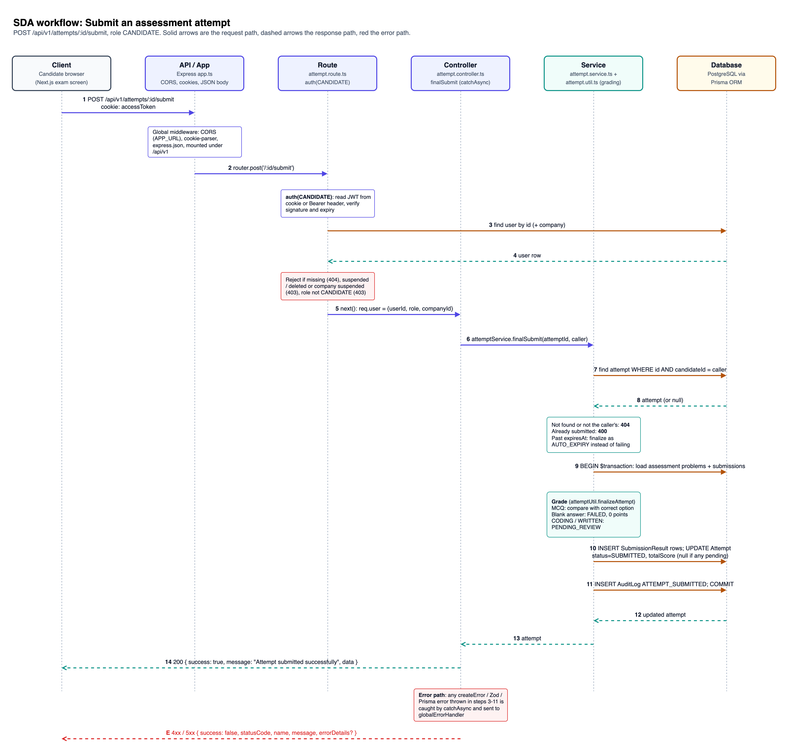
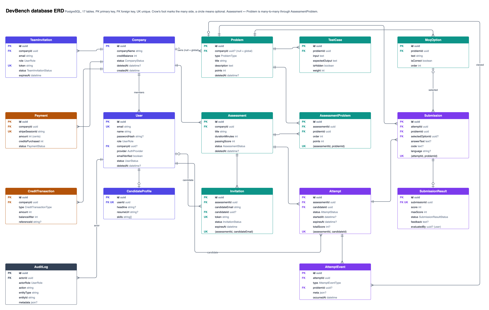
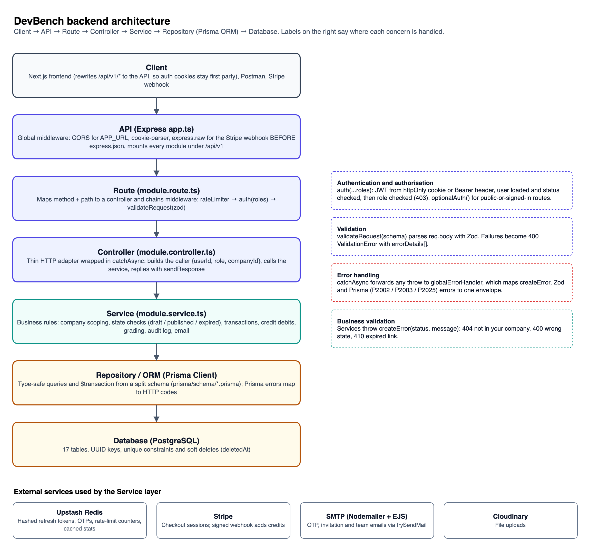

# DevBench: Backend System Design

This document describes the backend of **DevBench** as it is built: its requirements, a feature workflow, the database, the API and the architecture. Everything here is taken from the implementation in this repository (`src/`, `prisma/schema/`), so endpoints, fields, messages and status codes match the running API.

| File | What it is | Open it with |
|---|---|---|
| [`sda-workflow.drawio`](./sda-workflow.drawio) / [`.png`](./sda-workflow.png) | SDA workflow: submitting an assessment attempt | [Draw.io](https://app.diagrams.net) → File → Open |
| [`erd.drawio`](./erd.drawio) / [`.png`](./erd.png) | Database ERD, 17 tables | Draw.io |
| [`erd.dbml`](./erd.dbml) | The same ERD for dbdiagram.io | Paste into [dbdiagram.io](https://dbdiagram.io/d) |
| [`architecture.drawio`](./architecture.drawio) / [`.png`](./architecture.png) | Layered backend architecture | Draw.io |

## Contents

1. [Project requirements](#1-project-requirements)
2. [SDA workflow](#2-sda-workflow-submit-an-assessment-attempt)
3. [Database ERD](#3-database-erd)
4. [Backend API design](#4-backend-api-design)
5. [API request and response](#5-api-request-and-response-10-key-endpoints)
6. [Backend architecture](#6-basic-backend-architecture)

---

## 1. Project requirements

**Project name:** DevBench, a developer assessment platform.

**Main purpose:** let companies hire developers based on what they can actually do. A company builds a bank of coding, multiple-choice and written problems, bundles them into timed assessments, and invites candidates by email. Candidates take the test in the browser against a server-set deadline. MCQs are graded automatically, while coding and written answers go to the company's evaluators. The result is a ranked, evidence-backed view of every candidate, with an integrity check that catches copied answers.

**Target users:**
- Hiring companies: founders, hiring managers and technical interviewers who screen developers.
- Developer candidates applying for a role.
- The platform operator, who oversees companies, payments and abuse.

### User roles

| Role | Who | What they can do |
|---|---|---|
| `CANDIDATE` | A developer being assessed | Accept an invitation, take a timed attempt, save answers, submit, see their own results |
| `COMPANY_OWNER` | Creates the company account | Everything in the company, plus team management and buying credits |
| `ASSESSMENT_CREATOR` | Company member | Build problems and assessments, publish them and invite candidates |
| `EVALUATOR` | Company member | Review and score coding and written answers, see results and insights |
| `ADMIN` | Platform operator | See and manage all companies, users and payments, adjust credits, read the audit log |

Every non-admin request is scoped to the caller's own company. An admin sees across companies.

### Core features

1. **Authentication:** email and password registration with an OTP sent to verify the email, Google sign-in, rotating refresh tokens in httpOnly cookies, and password reset.
2. **Problem bank:** `CODING` problems with visible and hidden test cases, `MCQ` problems with options, and `WRITTEN` problems. Problems are reusable across assessments.
3. **Assessment builder:**
   - Lifecycle: `DRAFT` → `PUBLISHED` → `CLOSED`.
   - Each assessment has a duration and a passing score, and problems are attached with per-assessment points.
   - "Smart pick" suggests problems to fill the duration.
4. **Candidate invitations:** each invitation costs 1 credit, debited atomically. Invitations go by email, can be resent, and revoking one refunds the credit.
5. **Timed attempts:**
   - The server sets `expiresAt` when the attempt starts, and answers autosave.
   - Submitting finalizes the attempt; an expired attempt is finalized automatically on its next request.
6. **Grading and evaluation:**
   - MCQs are graded on submit.
   - Coding and written answers wait in a review queue, oldest first, until an evaluator scores them with feedback.
7. **Integrity and insights:**
   - Similarity detection (winnowing, the technique behind MOSS) and exam signals (tab switches, pastes).
   - Candidate ranking and percentile, plus item analysis of each question.
8. **Billing and administration:** credits are bought through Stripe Checkout and confirmed by a signed webhook. Admins can suspend or reactivate accounts and adjust credits, and every sensitive action is written to an audit log.

---

## 2. SDA workflow: submit an assessment attempt



**General flow:** User → API request → Route → Controller → Service / business logic → Database → API response → User.

**Feature shown:** a candidate submits their attempt. The request is `POST /api/v1/attempts/:id/submit`, role `CANDIDATE`. It is the most involved write in the system: it checks ownership and the deadline, grades every answer, and updates several tables in one transaction.

| Step | Layer | What happens |
|---|---|---|
| 1 | Client → API | The exam screen sends `POST /api/v1/attempts/:id/submit`. The `accessToken` httpOnly cookie travels with it, through the frontend's same-origin `/api/v1` rewrite. |
| – | API (app.ts) | Global middleware runs: CORS, limited to the frontend origin; `cookie-parser`; `express.json`. The request is then routed to the attempt module. |
| 2 | Route | `attempt.route.ts` matches `POST /:id/submit` and runs `auth(UserRole.CANDIDATE)`. |
| 3–4 | Route ↔ Database | **Authentication:** `auth` reads the JWT from the cookie or a `Bearer` header and verifies it, then loads the user and their company. |
| – | Route | **Authorization:** the request is rejected with 404 if the user is missing, 403 if the user is suspended or deleted or the company is suspended, and 403 if the role is not `CANDIDATE`. If all checks pass, `req.user = { userId, role, companyId }`. |
| 5–6 | Controller → Service | `attemptController.finalSubmit` runs inside `catchAsync`. It builds the caller and calls `attemptService.finalSubmit(attemptId, caller)`. The controller holds no business logic. |
| 7–8 | Service ↔ Database | The service loads the attempt with `WHERE id = :id AND candidateId = caller`. **Ownership is part of the query**, so another candidate's attempt is simply "not found" (404). |
| – | Service | **Business rules:** an already-submitted attempt is rejected with 400. If `expiresAt` has passed, the attempt is finalized as `AUTO_EXPIRY` instead of failing, so late requests still count. |
| 9 | Service → Database | A `$transaction` begins: it loads the assessment's problems with their points, plus the candidate's saved answers. |
| – | Service (grading) | `attemptUtil.finalizeAttempt` grades each problem. **MCQ:** full points if the chosen option is correct, otherwise 0. **Blank answer:** `FAILED` with 0 points. **Coding / written:** `PENDING_REVIEW` for an evaluator. |
| 10 | Service → Database | Inserts one `SubmissionResult` per problem. Updates the `Attempt` to `status = SUBMITTED` and sets `totalScore`, or leaves it `null` while any answer awaits review. |
| 11 | Service → Database | Writes an `AuditLog` entry `ATTEMPT_SUBMITTED` inside the same transaction, then commits. Either everything is saved or nothing is. |
| 12–13 | Database → Service → Controller | The updated attempt is returned up the stack. |
| 14 | Controller → Client | `sendResponse` replies `200 { success: true, message: "Attempt submitted successfully", data }`. |
| E | Error path | Any error thrown in steps 3–11 (`createError`, Zod or Prisma) is caught by `catchAsync` and passed to `globalErrorHandler`, which replies with the standard error envelope. |

---

## 3. Database ERD



PostgreSQL, accessed through Prisma ORM. **17 tables, 22 foreign keys.** Every primary key is a UUID. `Problem`, `Assessment`, `Company` and `User` are soft-deleted with `deletedAt`. The editable source is [`erd.drawio`](./erd.drawio), and [`erd.dbml`](./erd.dbml) renders the same schema on dbdiagram.io.

### Entities

| Table | Purpose | Key fields |
|---|---|---|
| `Company` | A hiring company and its credit wallet | `id` PK, `companyName`, `creditBalance`, `status` |
| `User` | Every account, of any role | `id` PK, `email` UK, `role`, `companyId` FK (null for candidates and admins), `provider`, `status` |
| `CandidateProfile` | Extra details for a candidate | `id` PK, `userId` FK UK, `headline`, `skills[]` |
| `TeamInvitation` | Invites a creator or evaluator into a company | `id` PK, `companyId` FK, `email`, `role`, `token` UK, `status`, `expiresAt` |
| `Payment` | A Stripe Checkout purchase | `id` PK, `companyId` FK, `stripeSessionId` UK, `amount`, `creditsPurchased`, `status` |
| `CreditTransaction` | Credit ledger entry | `id` PK, `companyId` FK, `type` (PURCHASE / DEDUCTION / REFUND / ADJUSTMENT), `amount`, `balanceAfter` |
| `Problem` | A reusable question | `id` PK, `companyId` FK (null = global), `type`, `title`, `description`, `points` |
| `TestCase` | Input and expected output for a coding problem | `id` PK, `problemId` FK, `input`, `expectedOutput`, `isHidden` |
| `McqOption` | An option of an MCQ | `id` PK, `problemId` FK, `text`, `isCorrect`, `order` |
| `Assessment` | A timed test | `id` PK, `companyId` FK, `title`, `durationMinutes`, `passingScore`, `status` |
| `AssessmentProblem` | **Junction table** linking assessments and problems | `id` PK, `assessmentId` FK, `problemId` FK, `order`, `points`, UK (assessmentId, problemId) |
| `Invitation` | A candidate's invitation to an assessment | `id` PK, `assessmentId` FK, `candidateEmail`, `candidateId` FK, `token` UK, `status`, `expiresAt` |
| `Attempt` | A candidate's sitting of an assessment | `id` PK, `assessmentId` FK, `candidateId` FK, `status`, `startedAt`, `expiresAt`, `totalScore`, UK (assessmentId, candidateId) |
| `Submission` | The answer to one problem in an attempt | `id` PK, `attemptId` FK, `problemId` FK, `selectedOptionId` FK, `answerText`, `code`, `language`, UK (attemptId, problemId) |
| `SubmissionResult` | The grade for one submission | `id` PK, `submissionId` FK UK, `score`, `maxScore`, `status`, `feedback`, `evaluatedBy` |
| `AttemptEvent` | An integrity signal from the exam screen | `id` PK, `attemptId` FK, `type`, `problemId` FK, `meta`, `occurredAt` |
| `AuditLog` | A record of sensitive actions | `id` PK, `actorId` FK, `actorRole`, `action`, `entityType`, `entityId`, `metadata` |

### Relationships

| Type | Relationship | Notes |
|---|---|---|
| One-to-one | `User` – `CandidateProfile` | `CandidateProfile.userId` is unique |
| One-to-one | `Submission` – `SubmissionResult` | `SubmissionResult.submissionId` is unique |
| One-to-many | `Company` → `User`, `TeamInvitation`, `Payment`, `CreditTransaction`, `Assessment` | A company owns its team, billing and tests |
| One-to-many (optional) | `Company` → `Problem` | `companyId` null means a global problem |
| One-to-many | `Problem` → `TestCase`, `McqOption` | The answer key, stored separately from the problem text |
| One-to-many | `Assessment` → `Invitation`, `Attempt` | |
| One-to-many | `Attempt` → `Submission`, `AttemptEvent` | |
| One-to-many | `User` → `Attempt`, `AuditLog`; `User` → `Invitation` (optional) | `Invitation.candidateId` is set when the candidate accepts |
| **Many-to-many** | `Assessment` ↔ `Problem` through `AssessmentProblem` | The same problem can sit in many assessments, with different points in each |
| Many-to-many | `User` (candidate) ↔ `Assessment` through `Attempt` | At most one attempt per candidate per assessment |

**Integrity rules enforced by the schema:**
- Each candidate gets one invitation per assessment, from UK (assessmentId, candidateEmail).
- Each candidate gets one attempt per assessment, from UK (assessmentId, candidateId).
- Each problem gets one answer per attempt, from UK (attemptId, problemId), so saving again updates the answer instead of duplicating it.
- Child rows (test cases, options, submissions, results, events) are deleted with their parent.

---

## 4. Backend API design

Base URL `/api/v1`. **72 endpoints across 13 modules.** "Auth" means a valid access token, sent as the httpOnly `accessToken` cookie or as `Authorization: Bearer <token>`. If the caller's role is not listed, the request fails with `403`.

"Company roles" = `COMPANY_OWNER`, `ASSESSMENT_CREATOR`, `EVALUATOR`. "Builders" = `ADMIN`, `COMPANY_OWNER`, `ASSESSMENT_CREATOR`.

### Auth (`/auth`)
| Method | Endpoint | Purpose | Auth | Roles |
|---|---|---|---|---|
| POST | `/auth/register` | Create an unverified account and email a 6-digit OTP | No (rate-limited) | – |
| POST | `/auth/verify-email` | Verify the OTP, activate the account, sign in | No (rate-limited) | – |
| POST | `/auth/resend-otp` | Send a new registration OTP, with a 60-second cooldown | No (rate-limited) | – |
| POST | `/auth/login` | Email and password login, sets auth cookies | No (rate-limited) | – |
| POST | `/auth/google` | Sign in or sign up with a Google ID token | No | – |
| POST | `/auth/refresh-token` | Rotate the refresh token and issue a new access token | Refresh cookie | – |
| POST | `/auth/forgot-password` | Email a password-reset OTP | No (rate-limited) | – |
| POST | `/auth/reset-password` | Reset the password with the OTP | No (rate-limited) | – |
| POST | `/auth/logout` | Revoke the refresh token and clear cookies | Yes | Any |

### Users (`/users`)
| Method | Endpoint | Purpose | Auth | Roles |
|---|---|---|---|---|
| GET | `/users/me` | Current user, with company and profile | Yes | Any |
| PATCH | `/users/me` | Update name, plus headline, resume URL and skills for candidates | Yes | Any |

### Companies (`/companies`)
| Method | Endpoint | Purpose | Auth | Roles |
|---|---|---|---|---|
| POST | `/companies` | Create a company; the caller becomes its owner | Yes | Any (without a company) |
| GET | `/companies/me` | Company profile and team members | Yes | Company roles |
| GET | `/companies/me/activity` | Dashboard charts: monthly activity, outcomes, average score by type | Yes | Company roles |
| PATCH | `/companies/me` | Rename the company | Yes | COMPANY_OWNER |
| GET | `/companies/credits` | Credit balance and the last 20 transactions | Yes | COMPANY_OWNER |
| POST | `/companies/team/invite` | Invite an assessment creator or evaluator | Yes | COMPANY_OWNER |
| POST | `/companies/team/accept/:token` | Accept a team invitation (signed in, or register on accept) | Optional | – |

### Problems (`/problems`)
| Method | Endpoint | Purpose | Auth | Roles |
|---|---|---|---|---|
| POST | `/problems` | Create a CODING, MCQ or WRITTEN problem | Yes | Builders |
| GET | `/problems` | List with `type`, `search`, pagination and sorting | Yes | Builders + EVALUATOR |
| GET | `/problems/:id` | Problem detail with test cases and options | Yes | Builders + EVALUATOR |
| PATCH | `/problems/:id` | Update a problem | Yes | Builders |
| DELETE | `/problems/:id` | Soft-delete a problem | Yes | Builders |

### Assessments (`/assessments`)
| Method | Endpoint | Purpose | Auth | Roles |
|---|---|---|---|---|
| POST | `/assessments` | Create a draft assessment | Yes | Builders |
| GET | `/assessments` | List with `status`, `search`, pagination | Yes | Builders + EVALUATOR |
| GET | `/assessments/:id` | Detail with attached problems | Yes | Builders + EVALUATOR |
| PATCH | `/assessments/:id` | Update; the duration locks once invitations exist | Yes | Builders |
| DELETE | `/assessments/:id` | Soft-delete an assessment | Yes | Builders |
| POST | `/assessments/:id/problems` | Attach one problem with order and points | Yes | Builders |
| POST | `/assessments/:id/problems/bulk` | Attach up to 50 problems at once | Yes | Builders |
| DELETE | `/assessments/:id/problems/:problemId` | Detach a problem | Yes | Builders |
| POST | `/assessments/:id/publish` | `DRAFT` → `PUBLISHED`; needs at least one problem | Yes | Builders |
| POST | `/assessments/:id/close` | `PUBLISHED` → `CLOSED` | Yes | Builders |
| POST | `/assessments/:id/invitations` | Invite a candidate, debiting 1 credit atomically | Yes | Builders |
| GET | `/assessments/:id/invitations` | List with `status`, `search` (email), pagination | Yes | Builders |
| POST | `/assessments/:id/invitations/:invitationId/resend` | Resend the invitation email | Yes (rate-limited) | Builders |
| GET | `/assessments/:id/results` | Every attempt with its score and verdict | Yes | Builders + EVALUATOR |
| POST | `/assessments/:id/attempts/start` | Start (or resume) the timed attempt | Yes | CANDIDATE |

### Invitations (`/invitations`)
| Method | Endpoint | Purpose | Auth | Roles |
|---|---|---|---|---|
| GET | `/invitations/me` | The candidate's own invitations | Yes | CANDIDATE |
| GET | `/invitations/accept/:token` | Public preview of an invitation (assessment, company, expiry) | No | – |
| POST | `/invitations/accept/:token` | Accept: link a signed-in candidate, or register a new one | Optional | – |
| PATCH | `/invitations/:id/invitations/:invitationId/revoke` | Revoke a pending invitation and refund the credit | Yes | Builders |

### Attempts (`/attempts`)
| Method | Endpoint | Purpose | Auth | Roles |
|---|---|---|---|---|
| GET | `/attempts/me` | The candidate's attempts, with max and passing score | Yes | CANDIDATE |
| GET | `/attempts/:id` | Attempt with problems; answer keys and hidden tests removed | Yes | CANDIDATE |
| POST | `/attempts/:id/submissions` | Save or overwrite the answer to one problem (autosave) | Yes | CANDIDATE |
| POST | `/attempts/:id/events` | Record up to 50 integrity events per request | Yes (rate-limited) | CANDIDATE |
| POST | `/attempts/:id/submit` | Finalize and grade the attempt | Yes | CANDIDATE |

### Evaluations (`/evaluations`)
| Method | Endpoint | Purpose | Auth | Roles |
|---|---|---|---|---|
| GET | `/evaluations/pending` | Review queue, oldest first, with `type` and `search` filters | Yes | Builders + EVALUATOR |
| GET | `/evaluations/:id` | One answer with its problem, test cases and candidate | Yes | Builders + EVALUATOR |
| PATCH | `/evaluations/:id` | Grade with score, status and feedback; final | Yes | Builders + EVALUATOR |

### Insights (`/insights`)
| Method | Endpoint | Purpose | Auth | Roles |
|---|---|---|---|---|
| GET | `/insights/submissions/:id/similarity` | Top 3 similar answers, with matching line ranges | Yes (rate-limited) | ADMIN + Company roles |
| GET | `/insights/attempts/:id/signals` | Tab switches, time away, pastes, question views | Yes | ADMIN + Company roles |
| GET | `/insights/attempts/:id` | Rank, percentile, score by type, written summary | Yes | ADMIN + Company roles |
| GET | `/insights/assessments/:id` | Ranking, histogram and item analysis | Yes | ADMIN + Company roles |
| GET | `/insights/assessments/:id/suggestions` | Smart pick: problems that fill the remaining time | Yes (rate-limited) | Builders |

### Payments (`/payments`)
| Method | Endpoint | Purpose | Auth | Roles |
|---|---|---|---|---|
| POST | `/payments/create-session` | Create a Stripe Checkout session for N credits | Yes | COMPANY_OWNER |
| POST | `/payments/webhook` | Stripe `checkout.session.completed`; adds credits idempotently | Stripe signature | – |
| GET | `/payments/history` | The company's payments, with a `status` filter | Yes | COMPANY_OWNER |

### Admin (`/admin`)
| Method | Endpoint | Purpose | Auth | Roles |
|---|---|---|---|---|
| GET | `/admin/stats` | Platform totals (cached) | Yes | ADMIN |
| GET | `/admin/stats/trends` | Monthly trends for companies, candidates, attempts and revenue | Yes | ADMIN |
| GET | `/admin/companies` | All companies, with search, status and pagination | Yes | ADMIN |
| PATCH | `/admin/companies/:id/suspend` | Suspend a company | Yes | ADMIN |
| PATCH | `/admin/companies/:id/reactivate` | Reactivate a company | Yes | ADMIN |
| GET | `/admin/candidates` | All candidates, with search, status and pagination | Yes | ADMIN |
| PATCH | `/admin/users/:id/suspend` | Suspend a user | Yes | ADMIN |
| PATCH | `/admin/users/:id/reactivate` | Reactivate a user | Yes | ADMIN |
| DELETE | `/admin/users/:id` | Soft-delete a user | Yes | ADMIN |
| GET | `/admin/payments` | All payments | Yes | ADMIN |
| POST | `/admin/credits/adjust` | Add or remove credits, with a reason | Yes | ADMIN |
| GET | `/admin/audit-logs` | The audit log, with entity filters | Yes | ADMIN |

### Public (`/public`, `/contact`)
| Method | Endpoint | Purpose | Auth | Roles |
|---|---|---|---|---|
| GET | `/public/stats` | Landing-page totals (cached) | No (rate-limited) | – |
| POST | `/contact` | Contact form, sent by email | No (rate-limited) | – |

**Rate limits** (per IP, Redis sliding window):
- 10 requests per minute on the "rate-limited" auth routes and on invitation resend.
- 5 per hour on the contact form.
- 100 per minute on the other limited routes.

---

## 5. API request and response: 10 key endpoints

Every response uses one envelope. Success responses carry `{ success, statusCode, message, data, meta? }`, where `meta = { page, limit, total }` on lists. Error responses carry `{ success: false, statusCode, name, message, errorDetails? }`. Validation errors also list each failing field in `errorDetails`.

### 1. Register: `POST /api/v1/auth/register`
**Auth:** none. Rate-limited to 10 per minute.

```json
{
  "name": "Jane Doe",
  "email": "jane@acme.com",
  "password": "Str0ng!Pass",
  "role": "COMPANY_OWNER",
  "companyName": "Acme Corp"
}
```
`role` is `CANDIDATE` (default) or `COMPANY_OWNER`. `companyName` is required for an owner. The password needs 8+ characters, with an uppercase letter, a lowercase letter, a number and a symbol.

**200 OK.** The account stays unverified until `POST /auth/verify-email`, which returns `201`.
```json
{
  "success": true,
  "statusCode": 200,
  "message": "OTP sent to your email — verify to complete registration",
  "data": { "email": "jane@acme.com", "otpExpiresInSeconds": 300 }
}
```
**400 Validation error**
```json
{
  "success": false,
  "statusCode": 400,
  "name": "ValidationError",
  "message": "Password must contain at least one special character.",
  "errorDetails": [{ "field": "password", "message": "Password must contain at least one special character." }]
}
```
Other errors: `409 An account with this email already exists`.

### 2. Login: `POST /api/v1/auth/login`
**Auth:** none. Rate-limited to 10 per minute.

```json
{ "email": "jane@acme.com", "password": "Str0ng!Pass" }
```
**200 OK.** Sets the httpOnly `accessToken` and `refreshToken` cookies.
```json
{
  "success": true,
  "statusCode": 200,
  "message": "User logged in successfully",
  "data": {
    "user": {
      "id": "7f1c…",
      "name": "Jane Doe",
      "email": "jane@acme.com",
      "role": "COMPANY_OWNER",
      "companyId": "c41a…",
      "emailVerified": true
    }
  }
}
```
Outside production, `data` also contains `accessToken` and `refreshToken` for Postman. In production the tokens travel only in the cookies.

**401 Unauthorized**
```json
{ "success": false, "statusCode": 401, "name": "Error", "message": "Invalid password credentials" }
```
Other errors:
- `404 User not found with this email`
- `403 Please verify your email before logging in`
- `403 Your account has been suspended`

### 3. Create a problem: `POST /api/v1/problems`
**Auth:** yes. Roles: ADMIN, COMPANY_OWNER, ASSESSMENT_CREATOR.

```json
{
  "title": "Two Sum",
  "description": "Return the indices of the two numbers that add up to the target.",
  "type": "CODING",
  "points": 20,
  "testCases": [
    { "input": "[2,7,11,15]\n9", "expectedOutput": "[0,1]" },
    { "input": "[3,3]\n6", "expectedOutput": "[0,1]", "isHidden": true }
  ]
}
```
An MCQ sends `mcqOptions: [{ "text", "isCorrect", "order" }]` instead.

**201 Created**
```json
{
  "success": true,
  "statusCode": 201,
  "message": "Problem created successfully",
  "data": {
    "id": "9b2e…",
    "type": "CODING",
    "title": "Two Sum",
    "points": 20,
    "companyId": "c41a…",
    "testCases": [{ "id": "…", "isHidden": false }, { "id": "…", "isHidden": true }]
  }
}
```
**400 Validation error**
```json
{
  "success": false,
  "statusCode": 400,
  "name": "ValidationError",
  "message": "Coding problems must include at least one test case",
  "errorDetails": [{ "field": "testCases", "message": "Coding problems must include at least one test case" }]
}
```
Other errors: `403 You do not have permission to access this resource` (for example, a candidate).

### 4. Create an assessment: `POST /api/v1/assessments`
**Auth:** yes. Roles: ADMIN, COMPANY_OWNER, ASSESSMENT_CREATOR.

```json
{
  "title": "Frontend Developer Screening",
  "description": "JavaScript and CSS basics, two coding problems and one written answer.",
  "durationMinutes": 45,
  "passingScore": 40
}
```
**201 Created**
```json
{
  "success": true,
  "statusCode": 201,
  "message": "Assessment created successfully",
  "data": {
    "id": "77730d67…",
    "status": "DRAFT",
    "title": "Frontend Developer Screening",
    "durationMinutes": 45,
    "passingScore": 40,
    "companyId": "c41a…"
  }
}
```
**400 Bad request**
```json
{ "success": false, "statusCode": 400, "name": "ValidationError", "message": "Duration must be a positive integer",
  "errorDetails": [{ "field": "durationMinutes", "message": "Duration must be a positive integer" }] }
```
Other errors: `400 You must belong to a company to create an assessment`.

### 5. Invite a candidate: `POST /api/v1/assessments/:id/invitations`
**Auth:** yes. Roles: ADMIN, COMPANY_OWNER, ASSESSMENT_CREATOR.

**Path:** `id` is the assessment ID.
```json
{ "candidateEmail": "amina.rahman@example.com" }
```
In one transaction, the company's balance is debited by 1 using `UPDATE … WHERE creditBalance > 0`, the invitation and a `DEDUCTION` ledger row are created, and the action is written to the audit log.

**201 Created**
```json
{
  "success": true,
  "statusCode": 201,
  "message": "Invitation sent successfully",
  "data": {
    "id": "e45a…",
    "candidateEmail": "amina.rahman@example.com",
    "status": "PENDING",
    "expiresAt": "2026-11-01T10:00:00.000Z",
    "emailSent": true
  }
}
```
**400 Bad request**
```json
{ "success": false, "statusCode": 400, "name": "Error", "message": "Insufficient credit balance to send this invitation" }
```
Other errors:
- `400 Only published assessments can receive invitations`
- `400 This candidate has already been invited to this assessment`
- `404 Assessment not found`, which is also what another company's assessment returns

### 6. Start an attempt: `POST /api/v1/assessments/:id/attempts/start`
**Auth:** yes. Role: CANDIDATE.

**Path:** `id` is the assessment ID. There is no body. Calling it again resumes the same in-progress attempt.

**200 OK**
```json
{
  "success": true,
  "statusCode": 200,
  "message": "Attempt started successfully",
  "data": {
    "id": "a9d2…",
    "assessmentId": "77730d67…",
    "status": "IN_PROGRESS",
    "startedAt": "2026-10-25T09:00:00.000Z",
    "expiresAt": "2026-10-25T09:45:00.000Z",
    "totalScore": null
  }
}
```
**403 Forbidden**
```json
{ "success": false, "statusCode": 403, "name": "Error", "message": "You have not been invited to this assessment" }
```
Other errors:
- `404 Assessment not found or not published`
- `400 You have already submitted this assessment`

### 7. Save an answer: `POST /api/v1/attempts/:id/submissions`
**Auth:** yes. Role: CANDIDATE.

**Path:** `id` is the attempt ID. The body shape depends on the problem type:
```json
{ "problemId": "9b2e…", "code": "function twoSum(nums, target) { … }", "language": "javascript" }
```
- MCQ: `{ "problemId", "selectedOptionId" }`
- Written: `{ "problemId", "answerText" }`

The answer is upserted, so saving again overwrites the previous answer.

**200 OK**
```json
{
  "success": true,
  "statusCode": 200,
  "message": "Answer saved successfully",
  "data": { "id": "5c7f…", "attemptId": "a9d2…", "problemId": "9b2e…", "language": "javascript", "updatedAt": "2026-10-25T09:12:31.000Z" }
}
```
**400 Bad request**
```json
{ "success": false, "statusCode": 400, "name": "Error", "message": "Your time expired and this attempt was automatically submitted" }
```
Other errors:
- `400 code is required for a CODING problem`
- `400 MCQ submissions only accept selectedOptionId`
- `404 This problem is not part of this assessment`

### 8. Submit an attempt: `POST /api/v1/attempts/:id/submit`
**Auth:** yes. Role: CANDIDATE. There is no body. This is the flow drawn in [section 2](#2-sda-workflow-submit-an-assessment-attempt).

**200 OK**
```json
{
  "success": true,
  "statusCode": 200,
  "message": "Attempt submitted successfully",
  "data": { "id": "a9d2…", "status": "SUBMITTED", "totalScore": null, "updatedAt": "2026-10-25T09:38:04.000Z" }
}
```
`totalScore` is `null` while any coding or written answer is `PENDING_REVIEW`. It is filled in when the last answer is graded.

**400 Bad request**
```json
{ "success": false, "statusCode": 400, "name": "Error", "message": "This attempt is already submitted" }
```
Other errors: `404 Attempt not found`, which is also what another candidate's attempt returns.

### 9. Grade an answer: `PATCH /api/v1/evaluations/:id`
**Auth:** yes. Roles: ADMIN, COMPANY_OWNER, ASSESSMENT_CREATOR, EVALUATOR.

**Path:** `id` is the SubmissionResult ID.
```json
{ "score": 15, "status": "PARTIAL", "feedback": "Correct approach; misses the empty-array case." }
```
`status` is `PASSED`, `FAILED` or `PARTIAL`. Grading is final. When this was the attempt's last pending answer, the attempt's `totalScore` is computed.

**200 OK**
```json
{
  "success": true,
  "statusCode": 200,
  "message": "Submission graded successfully",
  "data": { "id": "3e11…", "score": 15, "maxScore": 20, "status": "PARTIAL", "feedback": "Correct approach; misses the empty-array case.", "evaluatedAt": "2026-10-25T11:02:00.000Z" }
}
```
**400 Bad request**
```json
{ "success": false, "statusCode": 400, "name": "Error", "message": "Score cannot exceed the maximum of 20" }
```
Other errors:
- `400 This submission has already been graded and cannot be changed`
- `404 Submission not found`

### 10. Buy credits: `POST /api/v1/payments/create-session`
**Auth:** yes. Role: COMPANY_OWNER.

```json
{ "credits": 25 }
```
The price is computed on the server from `CREDIT_PRICE_IN_CENTS`, never sent by the client. A `PENDING` `Payment` row is created. Credits are added only when Stripe's signed webhook confirms the payment.

**200 OK**
```json
{
  "success": true,
  "statusCode": 200,
  "message": "Checkout session created successfully",
  "data": {
    "checkoutUrl": "https://checkout.stripe.com/c/pay/cs_test_…",
    "payment": { "id": "f02b…", "status": "PENDING", "amount": 2500, "creditsPurchased": 25 }
  }
}
```
**400 Validation error**
```json
{ "success": false, "statusCode": 400, "name": "ValidationError", "message": "Cannot purchase more than 1000 credits in a single session",
  "errorDetails": [{ "field": "credits", "message": "Cannot purchase more than 1000 credits in a single session" }] }
```
Other errors:
- `403 You do not have permission to access this resource` (not the owner)
- `401 No token provided`

---

## 6. Basic backend architecture



**Client → API → Route → Controller → Service → Repository / ORM → Database.** Each module in `src/modules/<name>/` follows these layers in the same files: `.route.ts`, `.controller.ts`, `.service.ts`, `.validation.ts`, `.interface.ts`.

| Layer | Where | Responsibility |
|---|---|---|
| **Client** | Next.js frontend, Postman, Stripe | Sends HTTP requests. The frontend calls `/api/v1/*` on its own origin and Next.js rewrites to the API, so auth cookies stay first party. |
| **API** | `src/app.ts`, `src/server.ts` | Express 5 application. Applies global middleware: CORS limited to `APP_URL`, cookie-parser, `express.raw` for the Stripe webhook (registered **before** `express.json` so the signature can be verified), and `express.json`. Mounts every module under `/api/v1` and registers `globalErrorHandler` last. |
| **Route** | `<module>.route.ts` | Maps method and path to a controller and chains per-route middleware in a fixed order: `rateLimiter` → **`auth(...roles)`** → **`validateRequest(zodSchema)`** → controller. |
| **Controller** | `<module>.controller.ts` | A thin HTTP adapter wrapped in `catchAsync`. Reads params, query and the validated body, builds the caller `{ userId, role, companyId }` from `req.user`, calls one service function, and replies through `sendResponse` with the standard envelope. No business logic. |
| **Service** | `<module>.service.ts`, `.util.ts` | All business rules, and the only layer that talks to the ORM:<br>- **Company scoping:** `resolveCompanyScope(caller)`.<br>- **State checks:** for example, publish needs problems, and an expired link returns 410.<br>- **Transactions:** credit debit with invitation, grading with result rows.<br>- **Audit log and email:** `writeAuditLog(…, tx)`; `trySendMail`, where failures are logged, not thrown.<br>- **Caching:** Redis. |
| **Repository / ORM** | Prisma Client (`src/lib/prisma.ts`), `prisma/schema/*.prisma` | Type-safe data access and `$transaction`. The schema is split by domain and migrated with `prisma migrate`. Prisma takes the place of a hand-written repository layer. |
| **Database** | PostgreSQL | 17 tables with UUID keys, unique constraints that enforce the business rules, and soft deletes. |

**Where cross-cutting concerns happen:**
- **Authentication:** in the **route layer**, through `auth()` in `src/middleware/auth.ts`.
  - It reads the JWT from the `accessToken` cookie or a Bearer header and verifies it.
  - It loads the user, then rejects deleted or suspended users and members of suspended companies.
  - `optionalAuth()` serves routes that work both signed in and out, such as accepting an invitation.
  - Refresh tokens are hashed in Redis, one per user, and rotated on every refresh.
- **Authorization:**
  - **Role:** `auth(UserRole.X, …)` returns `403 You do not have permission to access this resource` for any other role.
  - **Ownership:** handled in the **service**. Every query includes the caller's `companyId` (or `candidateId`), so another tenant's record reads as `404`, not `403`, and its existence isn't revealed.
- **Validation:**
  - **Request shape:** in the **route layer**. `validateRequest(schema)` parses `req.body` with Zod (types, lengths, enums, cross-field rules) and replaces it with the cleaned value; query parameters are parsed with Zod in the controller.
  - **Business validation:** in the **service**, for example "Only published assessments can receive invitations".
- **Error handling:** centralized.
  - Services throw `createError(status, message)`. `catchAsync` forwards any thrown error to `globalErrorHandler` (`src/middleware/globalErrorHandler.ts`).
  - The handler maps errors to the envelope: `ZodError` → 400 with `errorDetails[]`; Prisma `P2002` → 400 duplicate key, `P2003` → 400 foreign key, `P2025` → 404.
  - Stack traces are included only outside production.
- **Rate limiting:** Upstash Redis sliding windows, applied per route. Rate limiting fails open if Redis is unreachable, so an outage never blocks logins.
